# Шрифти проєкту «Рутенія»

Оригінальні файли OTF і TTF зі сторінок каталогу [abetkarutenia.com.ua/fonts](https://abetkarutenia.com.ua/fonts/).
Автор графіки — **Василь Чебаник (Vasyl Chebanyk)**. Відомості про цифрові версії, співавторів і оригінальні повідомлення з файлів наведено в `SOURCE.md` кожної теки.

Колекція містить **17 файлів OTF/TTF із 14 позицій каталогу**, доступних у зібраному наборі. Це не твердження про повноту всього поточного каталогу сайту.
Файли збережено без конвертації, перейменування або редагування. У кожної гарнітури своя тека; OTF і TTF включено разом, якщо обидва були у джерелі.

Зображення у таблиці — готові зменшені JPEG-версії зі сторінок гарнітур на сайті; натисніть на прев’ю, щоб відкрити його. Додаткові зразки та посилання на більші оригінали є в теках гарнітур. Джерела й контрольні суми зображень: [image-sources.json](image-sources.json).

| Зразок із сайту | Назва в каталозі | Завантаження | Відомості |
| --- | --- | --- | --- |
| <a href="chebanykgroteskcond/preview.jpg">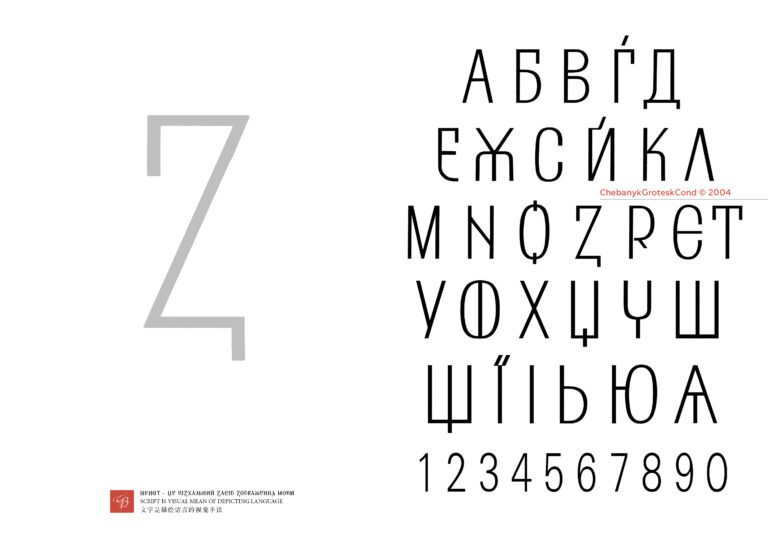</a> | [ChebanykGroteskCond](chebanykgroteskcond/) | [OTF](chebanykgroteskcond/GroteskChebanikCond-Regular.otf) | [Джерело й авторство](chebanykgroteskcond/SOURCE.md) |
| <a href="diduh/preview.jpg">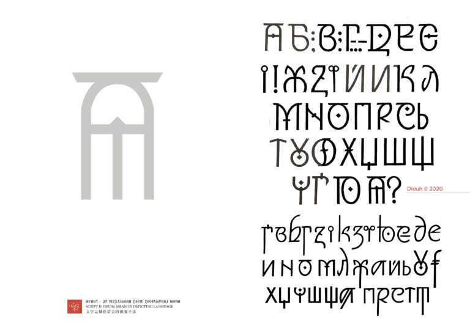</a> | [Diduh](diduh/) | [OTF](diduh/Diduh-Regular.otf), [TTF](diduh/Diduh-Regular.ttf) | [Джерело й авторство](diduh/SOURCE.md) |
| <a href="krasnopyschebanyk/preview.jpg">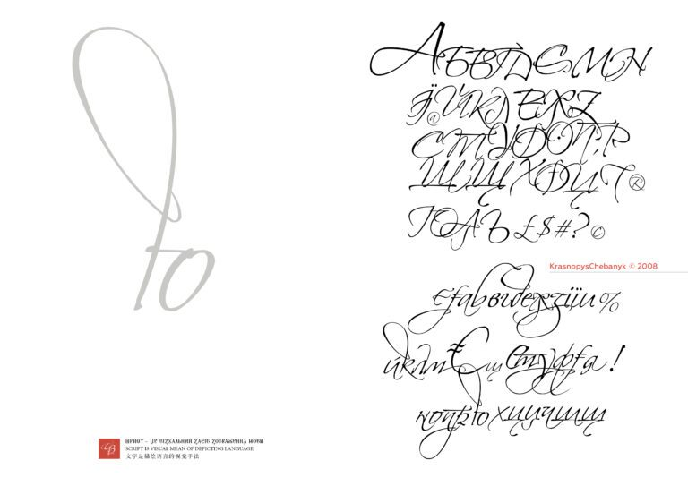</a> | [KrasnopysChebanyk](krasnopyschebanyk/) | [TTF](krasnopyschebanyk/KrasnopysChebanyk-Regular.ttf) | [Джерело й авторство](krasnopyschebanyk/SOURCE.md) |
| <a href="rutenia2008/preview.jpg">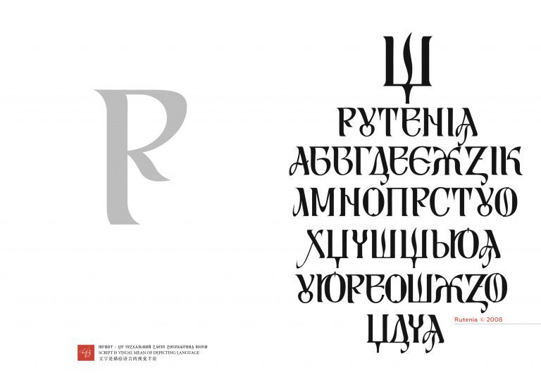</a> | [Rutenia](rutenia2008/) | [TTF](rutenia2008/Rutenia2008VasylChebanyk.ttf) | [Джерело й авторство](rutenia2008/SOURCE.md) |
| <a href="rutenia-italic/preview.jpg">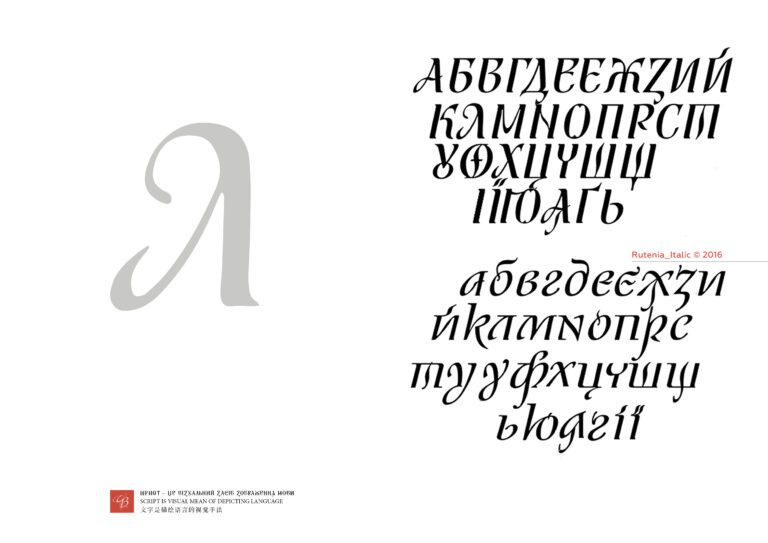</a> | [Rutenia Italic](rutenia-italic/) | [TTF](rutenia-italic/Rutenia2008VasylChebanykItalic.ttf) | [Джерело й авторство](rutenia-italic/SOURCE.md) |
| <a href="rutenia_bold2004/preview.jpg">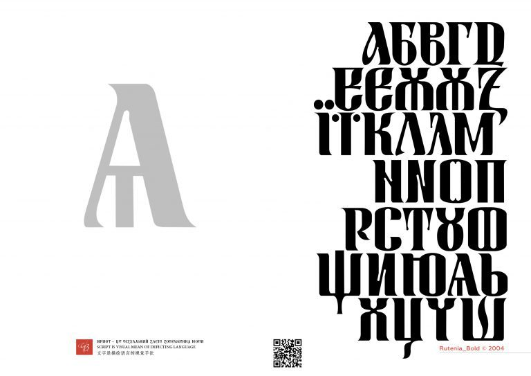</a> | [Rutenia_Bold](rutenia_bold2004/) | [OTF](rutenia_bold2004/Rutenia_Bold.otf) | [Джерело й авторство](rutenia_bold2004/SOURCE.md) |
| <a href="rutenia_nezalezhna/preview.jpg">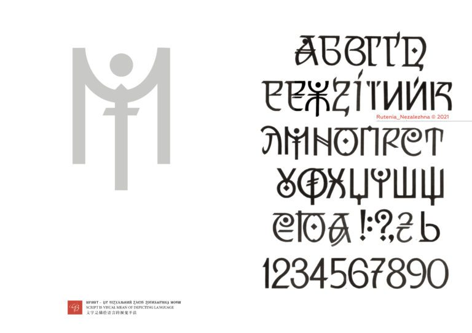</a> | [Rutenia_Nezalezhna](rutenia_nezalezhna/) | [OTF](rutenia_nezalezhna/Rutenia_Nezalezhna-Regular.otf) | [Джерело й авторство](rutenia_nezalezhna/SOURCE.md) |
| <a href="ruteniaakcidenta2008/preview.jpg">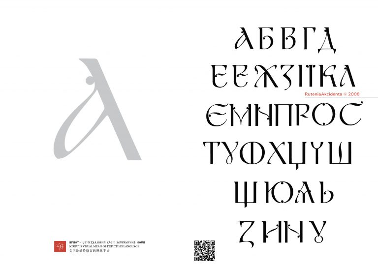</a> | [RuteniaAkcidentna](ruteniaakcidenta2008/) | [TTF](ruteniaakcidenta2008/RuteniaAkcidenta-Regular.ttf) | [Джерело й авторство](ruteniaakcidenta2008/SOURCE.md) |
| <a href="ruteniaarial2009/preview.jpg">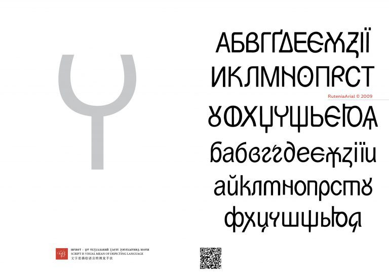</a> | [RuteniaArial](ruteniaarial2009/) | [TTF](ruteniaarial2009/RuteniaArial2009VasylChebanyk.ttf) | [Джерело й авторство](ruteniaarial2009/SOURCE.md) |
| <a href="ruteniadecor/preview.jpg">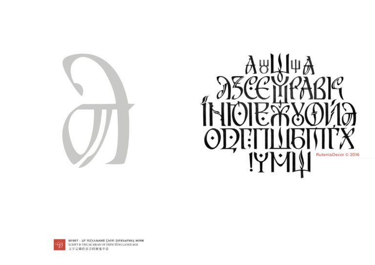</a> | [RuteniaDecor](ruteniadecor/) | [OTF](ruteniadecor/RuteniaDecor%20Regular.otf) | [Джерело й авторство](ruteniadecor/SOURCE.md) |
| <a href="ruthenia_rada/preview.jpg">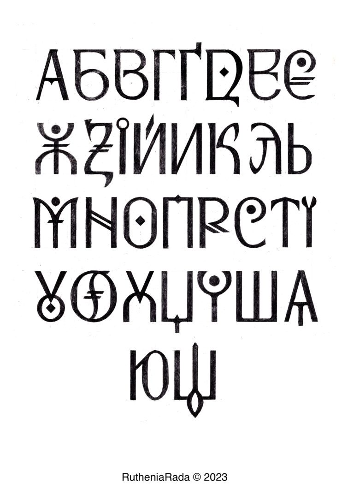</a> | [RutheniaRada](ruthenia_rada/) | [TTF](ruthenia_rada/RutheniaRada-Regular.ttf), [OTF](ruthenia_rada/RutheniaRada-Regular.otf) | [Джерело й авторство](ruthenia_rada/SOURCE.md) |
| <a href="rutheniaradatext/preview.jpg">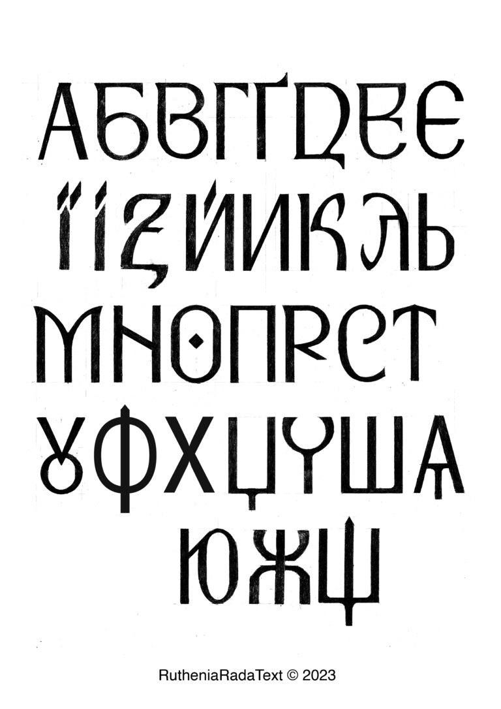</a> | [RutheniaRadaText](rutheniaradatext/) | [OTF](rutheniaradatext/RutheniaRadaText-Regular.otf), [TTF](rutheniaradatext/RutheniaRadaText-Regular.ttf) | [Джерело й авторство](rutheniaradatext/SOURCE.md) |
| <a href="shypshynacursive_italic2008/preview.jpg">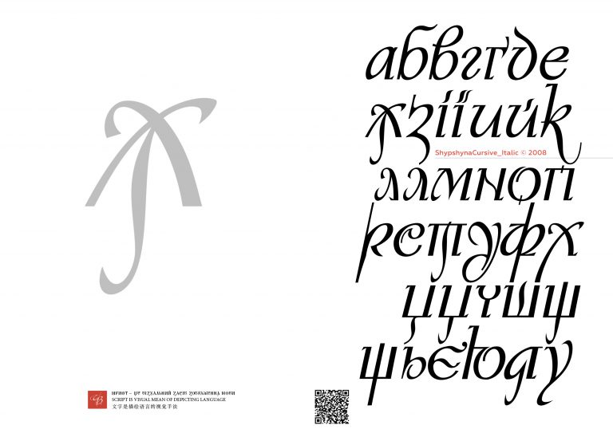</a> | [ShypshynaCursive_Italic](shypshynacursive_italic2008/) | [TTF](shypshynacursive_italic2008/ShypshynaCursiveItalic2008-Rg.ttf) | [Джерело й авторство](shypshynacursive_italic2008/SOURCE.md) |
| <a href="sofiakyivska2004/preview.jpg">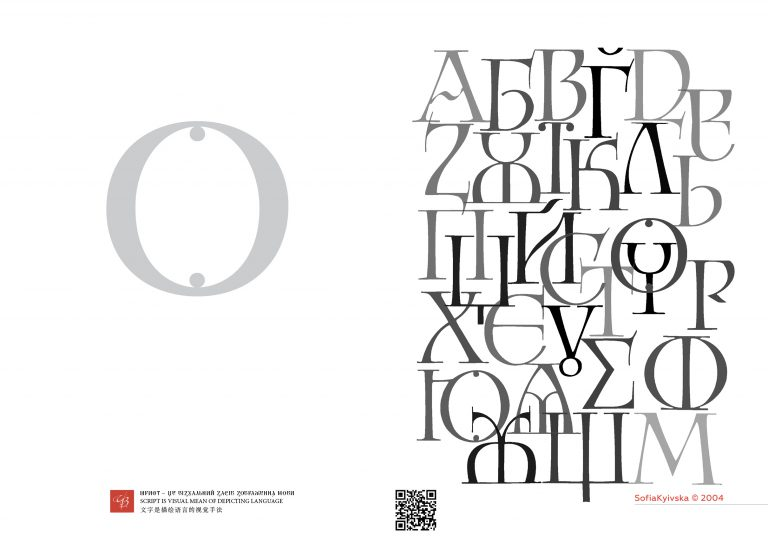</a> | [SofiaKyivska](sofiakyivska2004/) | [TTF](sofiakyivska2004/SofiaKyivska2004VasylChebanyk.ttf) | [Джерело й авторство](sofiakyivska2004/SOURCE.md) |

## Використання

Відкрийте потрібну теку та файл `.otf` або `.ttf`, натисніть **Download raw file** на GitHub і встановіть завантажений файл у своїй операційній системі.

## Умови та авторство

Сайт джерела зазначає Creative Commons Attribution-ShareAlike 4.0 (CC BY-SA 4.0). Умови та інші повідомлення з конкретних сторінок і файлів збережено в `SOURCE.md`; див. також [LICENSE-NOTICE.md](LICENSE-NOTICE.md).
При використанні зазначайте назву гарнітури, Василя Чебаника, [abetkarutenia.com.ua](https://abetkarutenia.com.ua/) та відповідну ліцензію. Додаткові авторські кредити наведено в описі кожної гарнітури.

## Перевірка походження

[manifest.json](manifest.json) містить URL сторінок і завантажень, розміри, оригінальні поля метаданих і SHA-256 кожного файла. [SHA256SUMS.txt](SHA256SUMS.txt) дає змогу перевірити цілісність файлів.

Дві вебверсії WOFF2 та супровідні README, які раніше були в цій теці, збережено на своїх місцях.

