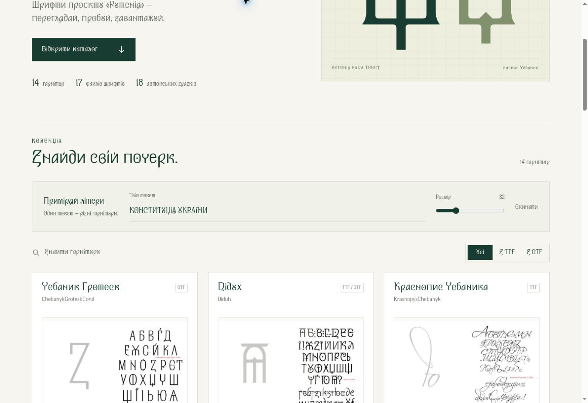
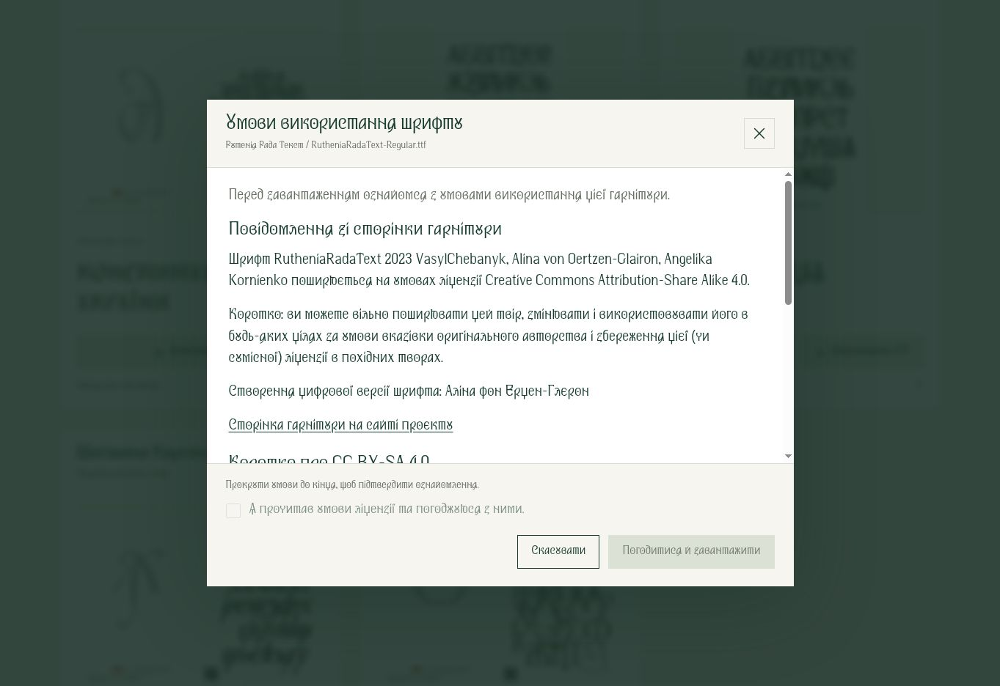
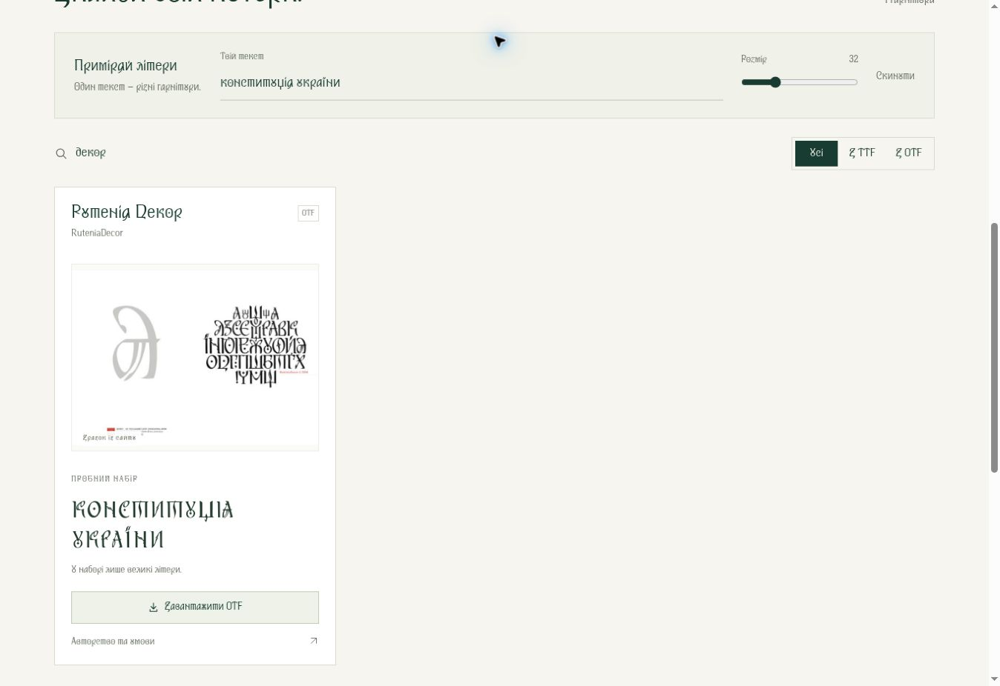
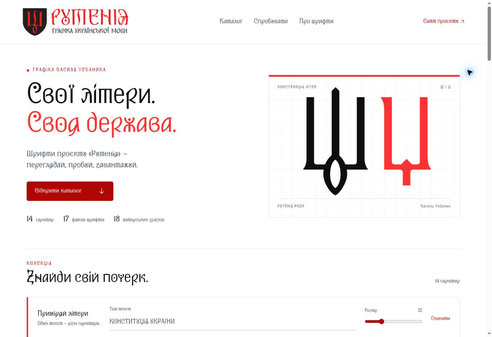

# Вебкаталог шрифтів «Рутенія»

[Відкрити вебкаталог](https://nestorvolya.github.io/infovarta/rutenia-fonts/)

14 гарнітур, 17 оригінальних файлів OTF/TTF та 18 зображень зі сторінок abetkarutenia.com.ua.

Основний текст і керування оформлено RutheniaRadaText, заголовки — RutheniaRada. Пробний текст у картках — відповідною гарнітурою. Пошук працює за українською назвою та оригінальною назвою файла; доступні фільтри за форматом, зміна пробного тексту й розміру, галерея зображень. Відсутні в конкретному файлі символи позначаються, щоб не підміняти їх іншою гарнітурою.

Сторінка працює на GitHub Pages без збірки та зовнішніх залежностей. Шрифти й зображення беруться із сусідньої теки [fonts](../fonts/). Оригінальні файли шрифтів не змінено.

Перевірено посилання на локальні ресурси, покриття символів інтерфейсу шрифтом, пошук, фільтри, пробний набір, скидання та галерею. Макет переглянуто на ширині 1363 і 390 пікселів.

Автор графіки — Василь Чебаник. Відомості про цифрові версії, співавторів, джерела та умови: [каталог файлів](../fonts/README.md).

## Погодження умов перед завантаженням

Кнопки завантаження відкривають діалог із повідомленнями зі сторінки конкретної гарнітури, коротким викладом CC BY-SA 4.0 та посиланнями на офіційний опис і повний текст ліцензії. Після перегляду тексту до кінця стає доступною позначка згоди; лише після неї можна запустити завантаження обраного файла.

Погодження скидається для кожного завантаження. Воно не зберігається на сервері або в браузері. Без JavaScript або при помилці завантаження даних кнопки залишаються заблокованими. Вікно підтверджує дію відвідувача в інтерфейсі, а не доводить фактичне прочитання; прямі посилання на публічні файли GitHub залишаються доступними.

## Великі та малі літери у пробному наборі

Rutenia_Bold, RuteniaAkcidentna, RuteniaDecor та SofiaKyivska мають лише великі накреслення. Частина кодів малих літер у цих файлах указує на ті самі контури, що й великі; інші коди малих літер відсутні. Це перевірено за таблицями Unicode та розкладеними контурами гліфів оригінальних файлів.

У `catalog-data.json` збережено `caseSubstitutions` та `uppercaseOnly`. Перед перевіркою відсутніх символів пробний текст підставляє відповідну велику літеру, якщо немає окремого малого накреслення. В інших гарнітурах введений регістр зберігається. Початковий текст у полі введення не змінюється.

Під зразками цих чотирьох гарнітур є коротка примітка «У наборі лише великі літери.». Справді відсутні символи, для яких немає і відповідної великої літери, надалі позначаються окремо. Файли шрифтів не змінено.

## Фірмовий стиль та кадрування зразків

Основне тло — #FFFFFF; акценти — #FD3333; заголовки — #0D0E0E; основний текст — #415161; підвал — #000000; невеликий кольоровий текст і кнопки з білими написами — #B10606.

Заголовки використовують оригінальний `RutheniaRada-Regular.ttf`, основний текст і керування — `RutheniaRadaText-Regular.ttf`. Зразки набрано відповідними оригінальними гарнітурами. RuteniaDecor збережено в його зразку як виразне акцентне накреслення.

У шапці й підвалі використано незмінений оригінальний PNG-логотип «Рутенія. Графіка української мови», 1967×542, зі збереженням пропорцій і кольорів #F02021 / #231F20. Джерело: https://abetkarutenia.com.ua/wp-content/uploads/2025/01/cropped-Ruthenia.png . Окремий логотип #інфоВАРТА не додавався.

Для 12 подвійних зразків `images[].crop` задає область правої шрифтової композиції. Картки та галерея використовують однакові координати. Окрему велику літеру ліворуч приховано кадруванням у верстці; контури літер у зображеннях не редагуються. Шість зображень RutheniaRada / RutheniaRadaText показано повністю.

## Контакти проєкту

Перед підвалом додано блок «Контакти проєкту»: info@abetkarutenia.com.ua, admin@abetkarutenia.com.ua та посилання на форму зворотного зв’язку. Джерело контактів — https://abetkarutenia.com.ua/contact/ (перевірено 31.10.2026). Електронні адреси відкривають поштову програму через `mailto:`; форма відкривається на офіційному сайті. У головному меню є перехід до блока.

## Виділення пробного набору

Пробний набір у кожній картці виділено світлим червонуватим тлом, тонкою рамкою та червоною вертикальною рискою. Напис «Пробний набір» став помітнішим; коротка примітка про великі літери зберігається всередині блока. Спільне поле введення має узгоджене тло й окреме біле поле.
